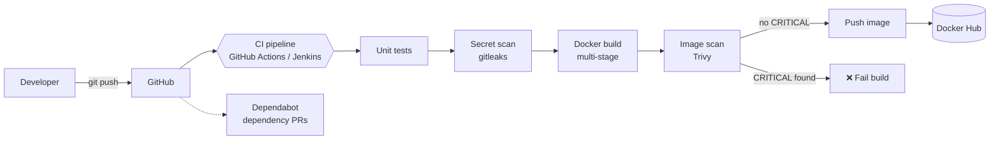

# Secure CI/CD Pipeline

A DevSecOps pipeline for a small Python web service. Every push is tested, scanned for leaked secrets, built into a container image, scanned for vulnerabilities, and published — and the pipeline **fails automatically** when it finds a critical issue.

The same pipeline runs on **GitHub Actions** and on **Jenkins**.

> 🚧 **Work in progress.** Built step by step as part of my [DevOps roadmap](https://github.com/nourseen6/roadmap). The checklist below shows what's done.

## Architecture



## Tech stack

| Area | Tools |
|---|---|
| Application | Python, FastAPI, PostgreSQL |
| Containers | Docker (multi-stage), Docker Compose |
| CI/CD | GitHub Actions, Jenkins |
| Security | gitleaks, Trivy, Dependabot |
| Scripting | Bash |

## Progress

- [x] Python API (links stored in memory for now)
- [ ] PostgreSQL database
- [x] Unit tests
- [x] Multi-stage Dockerfile — image reduced from 1.67 GB to 222 MB, runs as a non-root user
- [ ] Docker Compose for the app and database
- [ ] GitHub Actions: test → build → push
- [ ] Secret scanning with gitleaks
- [ ] Image scanning with Trivy, failing on CRITICAL
- [ ] Dependabot
- [ ] The same pipeline as a Jenkinsfile
- [ ] Red run and green run documented

## Project structure

```
.
├── app/
│   └── main.py             # FastAPI service
├── tests/
│   └── test_main.py        # Unit tests
├── docs/                   # Diagrams and screenshots (coming soon)
├── requirements.txt        # Runtime dependencies
├── requirements-dev.txt    # Test dependencies
├── README.md
└── LICENSE
```

## API

| Method | Endpoint | Description |
|---|---|---|
| `GET` | `/health` | Health check — returns `{"status": "ok"}` |
| `POST` | `/shorten` | Takes `{"url": "https://..."}` and returns a short code |
| `GET` | `/{code}` | Redirects to the original URL, or `404` if the code is unknown |

Interactive docs are served at `/docs` when the app is running.

## Getting started

Requirements: Python 3.12+.

```bash
python3 -m venv .venv
source .venv/bin/activate
pip install -r requirements-dev.txt
```

Run the tests:

```bash
pytest
```

Run the app, then open http://127.0.0.1:8000/docs:

```bash
uvicorn app.main:app --reload
```

### With Docker

```bash
docker build -t secure-cicd-pipeline .
docker run -d -p 8000:8000 --name url-shortener secure-cicd-pipeline
```

The image is a multi-stage build on `python:3.14-slim`. It runs as a non-root user and has a built-in health check on `/health`.

## What I learned

A short write-up of the problems I hit and how I solved them will be added here.

## License

[MIT](LICENSE)
