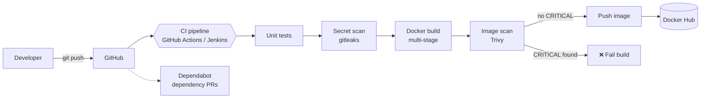

# Secure CI/CD Pipeline

A DevSecOps pipeline for a small Python web service. Every push is tested, scanned for leaked secrets, built into a container image, scanned for vulnerabilities, and published — and the pipeline **fails automatically** when it finds a critical issue.

The same pipeline runs on **GitHub Actions** and on **Jenkins**.

> 🚧 **Work in progress.** Built step by step as part of my [DevOps roadmap](https://github.com/nourseen6/roadmap). The checklist below shows what's done.

## Architecture



## Tech stack

| Area | Tools |
|---|---|
| Application | Python, FastAPI, PostgreSQL |
| Containers | Docker (multi-stage), Docker Compose |
| CI/CD | GitHub Actions, Jenkins |
| Security | gitleaks, Trivy, Dependabot |
| Scripting | Bash |

## Progress

- [ ] Python API with a PostgreSQL database
- [ ] Unit tests
- [ ] Multi-stage Dockerfile
- [ ] Docker Compose for the app and database
- [ ] GitHub Actions: test → build → push
- [ ] Secret scanning with gitleaks
- [ ] Image scanning with Trivy, failing on CRITICAL
- [ ] Dependabot
- [ ] The same pipeline as a Jenkinsfile
- [ ] Red run and green run documented

## Project structure

```
.
├── app/            # Python service (coming soon)
├── tests/          # Unit tests (coming soon)
├── docs/           # Diagrams and screenshots (coming soon)
├── README.md
└── LICENSE
```

## Getting started

Instructions will be added as each part is built.

## What I learned

A short write-up of the problems I hit and how I solved them will be added here.

## License

[MIT](LICENSE)
