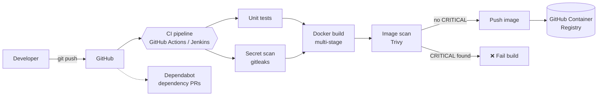

# Secure CI/CD Pipeline

[](https://github.com/nourseen6/secure-cicd-pipeline/actions/workflows/ci.yml)

A DevSecOps pipeline for a small Python web service. Every push is tested, scanned for leaked secrets, built into a container image, scanned for vulnerabilities, and published — and the pipeline **fails automatically** when it finds a critical issue.

The same pipeline runs on **GitHub Actions** and on **Jenkins**.

Project 1 of my [DevOps roadmap](https://github.com/nourseen6/roadmap).

## Architecture



## Tech stack

| Area | Tools |
|---|---|
| Application | Python, FastAPI, PostgreSQL |
| Containers | Docker (multi-stage), Docker Compose |
| CI/CD | GitHub Actions, Jenkins |
| Security | gitleaks, Trivy, Dependabot |
| Scripting | Bash |

## Features

- Python API
- PostgreSQL storage with parameterized queries
- Unit tests
- Multi-stage Dockerfile — image reduced from 1.67 GB to 222 MB, runs as a non-root user
- Docker Compose for the app and database, with health checks and the password kept out of Git
- GitHub Actions: test → build → push to the GitHub Container Registry
- Secret scanning with gitleaks across the full Git history
- Image scanning with Trivy — the image is pushed only if no fixable CRITICAL vulnerability is found
- Dependabot for Python packages, the base image, and GitHub Actions
- Every third-party action pinned to a commit SHA
- The same pipeline as a Jenkinsfile, on a local Jenkins configured as code
- Red run and green run documented — see [Security gates in action](#security-gates-in-action)

## Security gates in action

Each gate was tested on purpose, on a pull request that was then closed without merging.

| Scenario | 🔴 Blocked | 🟢 Fixed |
|---|---|---|
| **Hard-coded API key** in `app/config.py` | [gitleaks found it](https://github.com/nourseen6/secure-cicd-pipeline/actions/runs/40001783065) (`generic-api-key`); the image build was skipped | [Key moved to an environment variable](https://github.com/nourseen6/secure-cicd-pipeline/actions/runs/40001893687) and the leaking commit removed from history |
| **Outdated library**: `django==2.2.0` | [Trivy found 6 CRITICAL CVEs](https://github.com/nourseen6/secure-cicd-pipeline/actions/runs/40003321334), including CVE-2019-14234 (SQL injection); the image was not pushed | [Upgraded to Django 6.1.2](https://github.com/nourseen6/secure-cicd-pipeline/actions/runs/40003968577); the scan passes |

Pull requests: [#10](https://github.com/nourseen6/secure-cicd-pipeline/pull/10) and [#11](https://github.com/nourseen6/secure-cicd-pipeline/pull/11).

**Lesson from the secret demo:** deleting a leaked secret in a new commit is not enough — it stays in the Git history. The fix is to rotate the secret, load it from the environment, and remove it from history.

## Project structure

```
.
├── app/
│   ├── main.py             # FastAPI service
│   └── storage.py          # PostgreSQL or in-memory storage
├── tests/
│   └── test_main.py        # Unit tests
├── .github/
│   ├── workflows/ci.yml    # GitHub Actions pipeline
│   └── dependabot.yml      # Weekly dependency updates
├── jenkins/                # Local Jenkins: image, plugins, configuration as code
├── Jenkinsfile             # The same pipeline on Jenkins
├── Dockerfile              # Multi-stage, non-root image
├── docker-compose.yml      # App + PostgreSQL
├── .env.example            # Template for local secrets
├── requirements.txt        # Runtime dependencies
├── requirements-dev.txt    # Test dependencies
├── README.md
└── LICENSE
```

## API

| Method | Endpoint | Description |
|---|---|---|
| `GET` | `/health` | Health check — returns `{"status": "ok"}` |
| `POST` | `/shorten` | Takes `{"url": "https://..."}` and returns a short code |
| `GET` | `/{code}` | Redirects to the original URL, or `404` if the code is unknown |

Interactive docs are served at `/docs` when the app is running.

## Getting started

Requirements: Python 3.12+.

```bash
python3 -m venv .venv
source .venv/bin/activate
pip install -r requirements-dev.txt
```

Run the tests:

```bash
pytest
```

Run the app, then open http://127.0.0.1:8000/docs:

```bash
uvicorn app.main:app --reload
```

### With Docker

Pull the image the pipeline publishes:

```bash
docker run -d -p 8000:8000 ghcr.io/nourseen6/secure-cicd-pipeline:latest
```

Or build it yourself:

```bash
docker build -t secure-cicd-pipeline .
docker run -d -p 8000:8000 --name url-shortener secure-cicd-pipeline
```

The image is a multi-stage build on `python:3.14-slim`. It runs as a non-root user and has a built-in health check on `/health`.

Without a database, links are kept in memory and lost on restart.

### With Docker Compose (app + PostgreSQL)

```bash
cp .env.example .env    # then set your own POSTGRES_PASSWORD in .env
docker compose up -d --build
```

The app waits until PostgreSQL is healthy, and links are stored in a Docker volume, so they survive restarts. Stop everything with `docker compose down`.

### The pipeline on Jenkins

```bash
cp jenkins/.env.example jenkins/.env    # set JENKINS_ADMIN_PASSWORD and DOCKER_GID
docker compose -f jenkins/docker-compose.yml up -d --build
```

Open http://127.0.0.1:8080 and sign in as `admin`. Jenkins is configured from [`jenkins/casc.yaml`](jenkins/casc.yaml): there is no setup wizard, and the `secure-cicd-pipeline` job is created automatically. It checks `main` for new commits every five minutes and runs the [`Jenkinsfile`](Jenkinsfile): unit tests → gitleaks → image build → Trivy. Pushing to ghcr.io is optional: add a `ghcr` username/token credential in Jenkins and run the job with `PUSH_IMAGE` checked.

## What I learned

- **Order the gates from cheapest to most expensive.** Tests and the secret scan run in parallel and take seconds; the image is built only if both pass, and pushed only if Trivy passes.
- **A smaller image is a safer image.** The multi-stage build cut the image from 1.67 GB to 222 MB, and fewer packages means fewer vulnerabilities for Trivy to find.
- **Deleting a leaked secret isn't enough.** It stays in the Git history, which is why gitleaks scans every commit and the real fix is to rotate the secret and load it from the environment.
- **Pin what you run.** Actions are pinned to commit SHAs, so a hijacked tag can't change the pipeline, and Dependabot keeps those pins current.
- **Least privilege everywhere.** The workflow can only read the repo by default; only the build job can publish packages, and only on pushes to `main`. The container runs as a non-root user.
- **Problems I hit:** files created as `root` that my user couldn't edit (fixed with `chown`), a port already taken by an old container, Node 20 being removed from GitHub runners (upgraded every action), and Docker volume paths when Jenkins starts containers on the host engine (solved with `--volumes-from`).

## License

[MIT](LICENSE)
